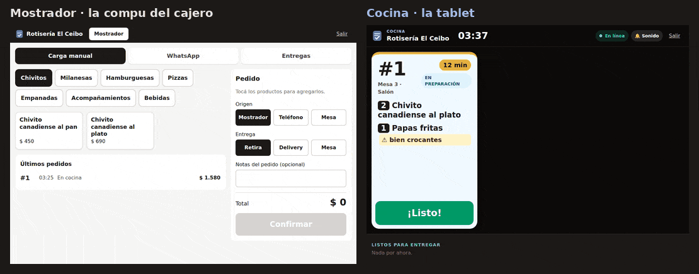
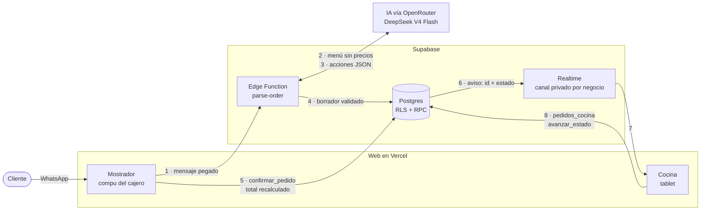

# Anotado

> Los pedidos de WhatsApp, anotados solos.



Los locales de comida reciben pedidos por WhatsApp y los anotan en papel: se mezclan, se pierden, llegan tarde. Anotado convierte esos mensajes en pedidos ordenados que aparecen en la pantalla de cocina en tiempo real. **La IA propone el pedido, una persona lo confirma.** El cliente no cambia nada: sigue escribiendo por WhatsApp como siempre.

**Demo en vivo:** _link al publicar la v0.1_. El acceso es con usuario, pedilo por mensaje. No hay usuario público para no dejar abierto el gasto de IA.

## Qué hace

- **Mostrador:** carga manual con botones grandes, o pegar el mensaje de WhatsApp y dejar que la IA arme el borrador. Lo dudoso aparece marcado, nunca inventado. Se confirma con un toque.
- **Cocina:** una tablet con las tarjetas en orden de llegada (lo más viejo a la izquierda), número gigante, notas resaltadas y temporizador verde/amarillo/rojo. Suena cuando entra un pedido, mantiene la pantalla encendida y avisa si se corta internet. Al volver la conexión recarga todo: un corte no pierde pedidos.
- **Entregas:** los listos para entregar con dirección y total, y cancelar con motivo.
- **Multi-local desde el día uno:** cada negocio ve solo lo suyo, con roles de dueño, cajero y cocina.

## Arquitectura



Detalle de cada flujo en [`docs/arquitectura.md`](docs/arquitectura.md).

## Decisiones clave

- **El estado vive en la base, no en la IA.** La IA traduce texto a acciones; el borrador del pedido está en Postgres.
- **La IA propone, el humano confirma.** Lo dudoso se marca, nunca se inventa.
- **Aislamiento por negocio con RLS** en todas las tablas, verificado con 210 tests pgTAP que corren en cada PR.
- **Los precios nunca salen de la IA.** El total se recalcula en el servidor.
- **La cocina ve solo lo que cocina.** Lee por una RPC sin dirección ni teléfono, y Realtime avisa solo "cambió el pedido X": la lista siempre se recarga desde la base, así un aviso perdido no deja la pantalla mal.
- **La IA se prende por local, con dos llaves:** la habilita el operador y la prende o apaga el dueño.

El porqué de cada una, en [`docs/decisiones.md`](docs/decisiones.md).

## Evals del parser

26 casos en 11 categorías: pedidos simples, notas, ortografía, varios mensajes, cambios de opinión, referencias vagas, fuera de menú, cantidades absurdas, intentos de manipulación, audios mal transcritos y mensajes que no son pedidos.

| Modelo (OpenRouter) | Aciertos | Costo de la corrida |
|---|---|---|
| **DeepSeek V4 Flash** (proveedores que no retienen datos) | **25/26** | US$ 0,004 |
| Qwen 3.7 Flash | 24/26 | US$ 0,0015 |
| GLM 4.7 Flash | 21/26 | US$ 0,003 |

El único fallo del elegido marca "coca grnde" como dudoso: el error seguro. Costo estimado: **~US$ 0,50 por local por mes**. Se corren a mano (`pnpm eval`), no en CI, porque gastan tokens.

## Stack

React + TypeScript (Vite, Tailwind) · Supabase (Postgres, Auth, Realtime, Edge Functions) · Zod · Vitest · pgTAP · pnpm workspaces · Vercel.

## Correrlo localmente

Requisitos: Node 24, pnpm y Docker Desktop.

```bash
pnpm install
pnpm db:start          # levanta Supabase local, aplica migraciones y seed
pnpm db:test           # tests de la base (aislamiento, roles, cocina, confirmar_pedido…)
pnpm test              # tests de packages/shared
```

Copiá `.env.example` a `apps/web/.env.local` con la URL y la publishable key que imprime `pnpm supabase status`, y después:

```bash
pnpm dev
```

Usuarios de prueba (contraseña `anotado123`): `dueno@elceibo.test`, `cajero@elceibo.test`, `cocina@elceibo.test`, `dueno@laesquina.test`. La cocina está en `/el-ceibo/cocina`.

Para la IA en local: copiá `supabase/functions/.env.example` a `supabase/functions/.env`, completá la key y corré `pnpm supabase functions serve`.

Para entrar con tu propio mail, copiá `supabase/seed.local.example.sql` a `supabase/seed.local.sql` (ignorado por git), poné tu mail y corré `pnpm db:reset`.

Panel local: Studio en http://127.0.0.1:54323 (tablas, usuarios, SQL) y Mailpit en http://127.0.0.1:54324 (mails que manda Auth).

Deploy: [`docs/deploy.md`](docs/deploy.md).

## Estructura

```
apps/web            Frontend (mostrador, cocina, admin)
packages/shared     Schemas y lógica pura compartida (web + Edge Functions)
supabase/           Migraciones, seed, tests pgTAP y Edge Functions
evals/              Casos y runner de evals del parser
docs/               Arquitectura, decisiones y deploy
```

## Próximos pasos

- **Fase 4, multi-empresa real:** alta de negocio, invitaciones y roles, horarios y zonas de envío.
- **Fase 5, WhatsApp real:** Cloud API de Meta, y el pedido aparece en revisión sin pegar nada.
- **Fase 6, el bot responde:** aclaraciones y confirmación del pedido por WhatsApp.
- Impresión de comandas en impresoras térmicas.
