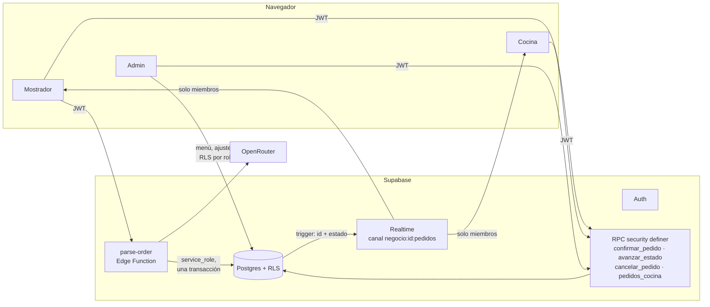
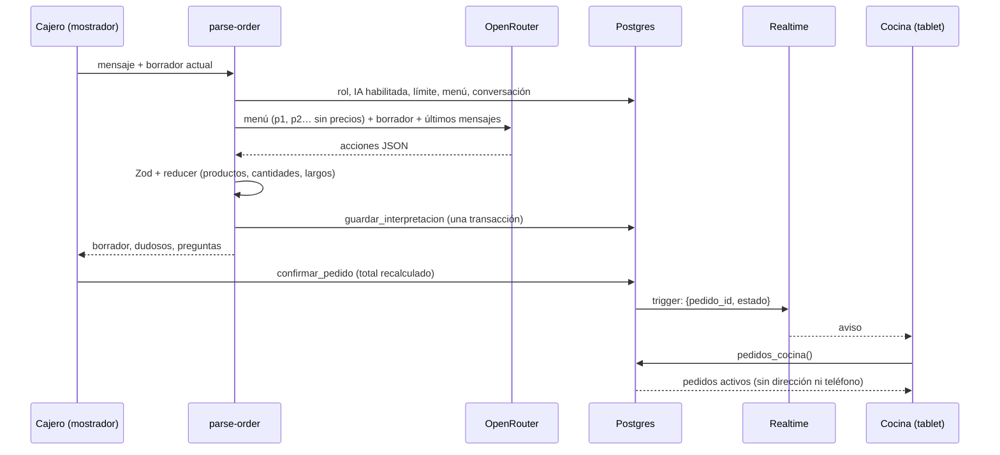
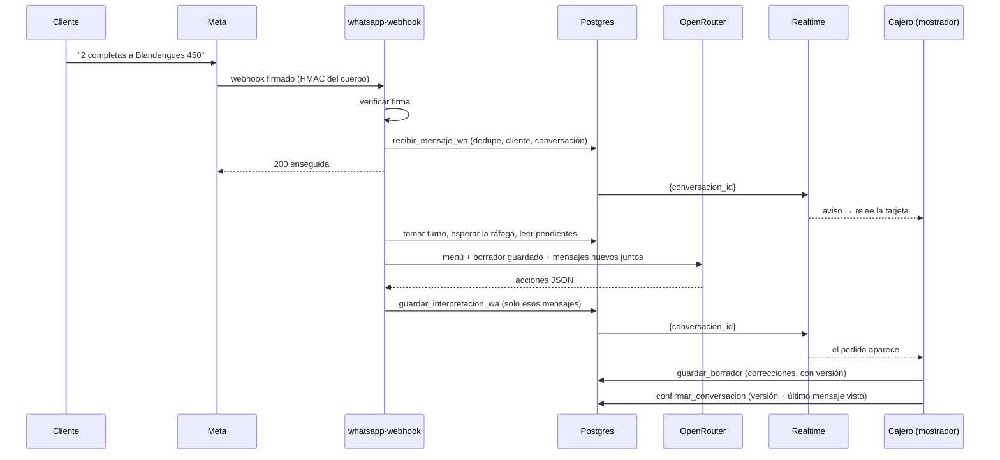

# Arquitectura

## Quién escribe qué

| Qué | Cómo | Por qué |
|---|---|---|
| Menú, ajustes, horarios, zonas de envío | Directo a la tabla, con RLS por rol | Es lo que el dueño edita a mano |
| Agotados | `marcar_agotado` (cualquier rol del local) | Solo toca `productos.activo`; precio y nombre siguen siendo del dueño |
| Pedidos | `confirmar_pedido` (cajero, dueño) | Recalcula el total desde `productos` y el envío desde `zonas_envio`, ignora precios del cliente |
| Cuentas | Edge Function `registro` | Solo con código de alta o invitación vigentes; la cuenta nace sin contraseña y se confirma por mail |
| Locales | `crear_negocio` | Negocio + primer dueño en una transacción, consume el código del operador |
| Equipo | `crear_invitacion` / `aceptar_invitacion` / `cambiar_rol` / `quitar_miembro` | Solo el dueño; el local nunca queda sin dueño |
| Operador: IA, suspensión, códigos | `operador_*` | Solo quien está en `operadores` y verificó el código del celular (`aal2`); no ve el contenido de los locales |
| Estado del pedido | `avanzar_estado` / `retroceder_estado` / `cancelar_pedido` | Solo cambian el estado, y cada rol solo mueve lo de su área |
| Borrador de WhatsApp (pegado) | `parse-order` → `guardar_interpretacion` | La IA no escribe: todo se guarda en una transacción al final |
| Mensajes de WhatsApp (Meta) | `whatsapp-webhook` → `recibir_mensaje_wa` | Firma de Meta verificada; se guarda antes de contestar, con dedupe por `wa_message_id` |
| Borrador de WhatsApp (Meta) | intérprete → `guardar_interpretacion_wa` | Turno por conversación; marca solo los mensajes que leyó la IA |
| Correcciones del cajero | `guardar_borrador` (cajero, dueño) | Con versión: la IA siempre parte de lo corregido |
| Pedido de WhatsApp | `confirmar_conversacion` → `confirmar_pedido` | Exige la última versión y que no haya mensajes después del último que se ve |

## Un pedido de WhatsApp, de punta a punta

### Con WhatsApp conectado

## Cocina: nunca perder un pedido

Realtime es solo un aviso de que algo cambió; la verdad es siempre `pedidos_cocina()`. La lista completa se recarga:

1. Al suscribirse al canal, y otra vez en cada reconexión (Realtime vuelve a mandar `SUBSCRIBED`).
2. Al volver internet (`online`) y al volver a la pestaña (`visibilitychange`).
3. Cada 30 s, por si el websocket murió sin avisar (típico en tablets que se duermen).

Varios avisos seguidos se juntan en una sola recarga, y nunca corren dos cargas a la vez. El temporizador usa la hora del servidor (con el desfase medido en cada carga), no el reloj de la tablet.

Cambiar un estado manda el estado que se ve en pantalla (`desde`): si otro dispositivo ya lo movió, la base no hace nada y devuelve el estado real. Así un doble toque o un reintento después de un corte no saltea un paso.

## Seguridad por capas

- **RLS** en todas las tablas y **GRANTs mínimos**: `anon` no tiene nada salvo la RPC `ping()` (sin datos, para que el plan gratis no pause el proyecto), y cada tabla o función declara sus permisos.
- **FKs compuestas `(id, negocio_id)`**: la base impide cruzar datos entre negocios aunque falle lo de arriba.
- **Cocina** no lee `pedidos` ni `pedido_items` directo: solo por `pedidos_cocina()`.
- **Realtime** con canales privados: una policy sobre `realtime.messages` deja escuchar solo a los miembros del negocio, y nadie manda avisos desde el navegador.
- **IA**: la key vive en los secrets de Supabase; la web nunca la ve. Hay límites por usuario y por negocio, y dos llaves de acceso por local.
- **Web**: CSP que solo permite conectarse a Supabase (`apps/web/vercel.json`).
